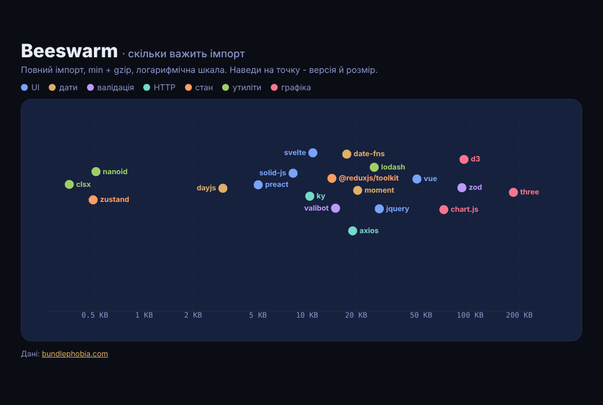

# Beeswarm

Beeswarm на D3: розмір 20 популярних бібліотек — повний імпорт, min + gzip, за bundlephobia — на логарифмічній осі. Точки розсуває `d3.forceSimulation`, підписи стають туди, де вільно. Наведи на точку — версія й розмір, на категорію в легенді — решта тьмяніє.

> Пост [@nby.frontend](https://instagram.com/nby.frontend) #223 · папка `Beeswarm`



## Запуск

```bash
npm i && npm run dev
```

Оновити розміри до останніх версій:

```bash
node scripts/fetch-sizes.mjs > src/data.js
```

## Як це працює

1. **Шкала** (`src/main.js`) — `d3.scaleLog().domain([0.25, 250])`: 0,35 KB і 185 KB на одній осі, кожен десяток — однакова відстань.
2. **Рій** — `d3.forceSimulation(nodes)` з трьома силами: `forceX` тягне точку до її розміру (сила 1 — x майже точний), слабкий `forceY` тримає рій біля центру, `forceCollide` не дає точкам перекриватись. `.stop().tick(300)` рахує все одразу, без анімації.
3. **Підписи** — для кожної точки по черзі пробуємо чотири місця (праворуч, ліворуч, над, під) і беремо перше, що не перетинається з точками й іншими підписами. Якщо вільного місця немає — назва лише в тултипі.
4. **Легенда** — `classed("dim", ...)` приглушує всі категорії, крім наведеної.

## Дані (26.10.2026)

Найлегші — clsx 0,35 KB, zustand 0,49, nanoid 0,51; найважчі — three 185 KB, d3 92, zod 89. Пари з поста: moment 20,3 → dayjs 3,1 (×6,6), zod 88,9 → valibot 14,7 (×6), axios 18,9 → ky 10,7 (×1,8).

Це **повний імпорт**: lodash і date-fns з точковими імпортами дають у бандлі в рази менше, moment і повний d3 — ні. `react` не включено: bundlephobia міряє лише пакет `react` без `react-dom`.

## Файли

- `src/main.js` — шкала, симуляція, підписи, тултип
- `src/data.js` — розміри й версії
- `scripts/fetch-sizes.mjs` — збір з bundlephobia (Node 18+, без залежностей)
- `src/style.css` — Tokyo Night стилі

---

EN: D3 beeswarm of 20 popular libraries by full-import size (min+gzip, bundlephobia) on a log scale, laid out with forceSimulation (forceX/forceY/forceCollide) and collision-aware labels. `npm i && npm run dev`.
