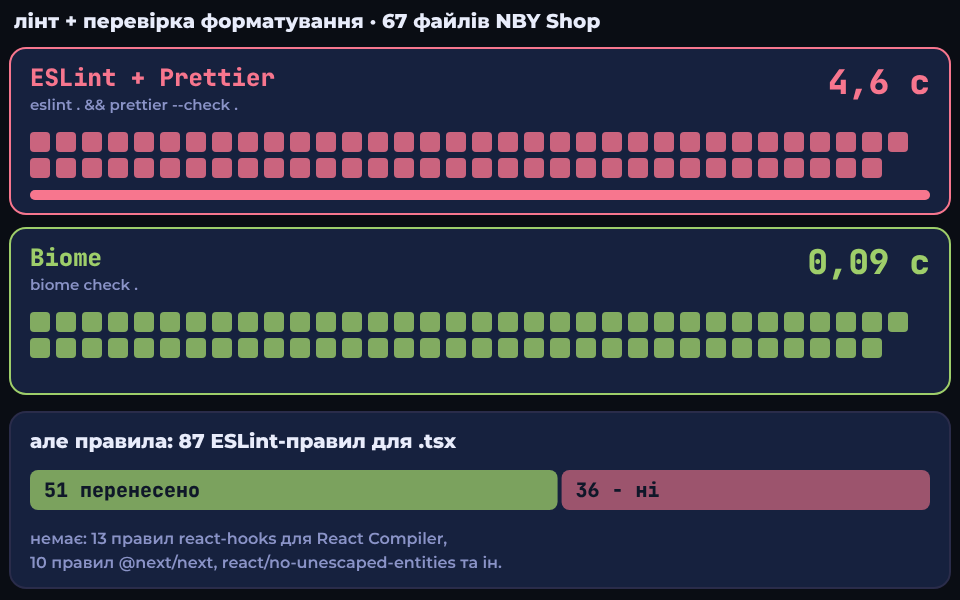

# BiomeVsEslint

Biome замість ESLint + Prettier на справжньому проєкті — NBY Shop (Next.js 16, 67 файлів `.ts` / `.tsx`): скільки часу займає перевірка і які правила не переїдуть.

> Пост [@nby.frontend](https://instagram.com/nby.frontend) #239 · папка `BiomeVsEslint`



## Як повторити на своєму проєкті

```bash
cd my-app
npm i -D @biomejs/biome
npx biome init
npx biome migrate eslint --write     # переносить правила з eslint.config.*
npx biome migrate prettier --write   # переносить .prettierrc і .prettierignore
npx biome migrate eslint             # без --write - звіт: що перенеслось, що ні

cd ../BiomeVsEslint
node scripts/bench.mjs ../my-app 5   # eslint, eslint --cache, prettier, biome lint/format/check → results.json
```

## Результат (12.11.2026)

ESLint 9.39.5 + eslint-config-next 16.3.5, Prettier 3.9.8, Biome 2.6.7. Linux, 2 ядра, медіана з 5:

| команда | час |
|---|---|
| `eslint .` | 3 338 ms |
| `eslint --cache .` (теплий кеш) | 851 ms |
| `prettier --check .` | 1 230 ms |
| **ESLint + Prettier** | **4 568 ms** |
| `biome lint .` | 77 ms |
| `biome format .` | 71 ms |
| **`biome check .`** (лінт + формат) | **92 ms** — у 50 разів швидше |

## Що не переїхало

ESLint вмикає для `.tsx` у цьому проєкті 87 правил ([`rules.json`](rules.json)):

- **51 перенесено**: 49 напряму, 2 в експериментальну групу Biome (nursery).
- **26 Biome не реалізував.** Серед них 13 правил `react-hooks` для React Compiler (`purity`, `refs`, `set-state-in-effect`, `immutability`…), `react/no-unescaped-entities`, `react/display-name`, `import/no-anonymous-default-export`.
- **10 правил `@next/next`** Biome не знає зовсім (`no-html-link-for-pages`, `no-css-tags`, `no-typos`…). Частину інших Next.js-правил він має власні (`noHeadElement`, `useGoogleFontDisplay`).

Повний звіт `biome migrate eslint` лежить у [`migrate-eslint.log`](migrate-eslint.log), отриманий конфіг — у [`biome.json`](biome.json). У конфігу вимкнено `assist` (сортування імпортів) і увімкнено `css.parser.tailwindDirectives`, щоб розбирався синтаксис Tailwind v4.

## Сюрпризи після переходу

- **`// eslint-disable-next-line` Biome не читає.** Через це з'явились 4 попередження `useExhaustiveDependencies` там, де ESLint був вимкнений коментарем. Для Biome потрібен `// biome-ignore lint/correctness/useExhaustiveDependencies: <пояснення>`.
- **Зламаний коментар у `app/globals.css`.** У тексті коментаря є `--color-*/`, і `*/` закриває коментар раніше часу. Prettier мовчки «відформатував» залишок у рядки-сміття, а Biome показав parse error.
- **Форматер Biome відрізняється від Prettier у 2 файлах:** перенос довгого `extends` в інтерфейсі й масиви в `package.json`.

## Файли

- `scripts/bench.mjs` — заміри часу, `results.json`
- `biome.json`, `rules.json`, `migrate-eslint.log` — конфіг і звіт міграції для NBY Shop

---

EN: Biome vs ESLint + Prettier on a real Next.js app (67 files): 4.6 s vs 0.09 s (×50). But only 51 of 87 enabled ESLint rules migrate: no React Compiler hooks rules, no `@next/next` rules, and `eslint-disable` comments are ignored.
