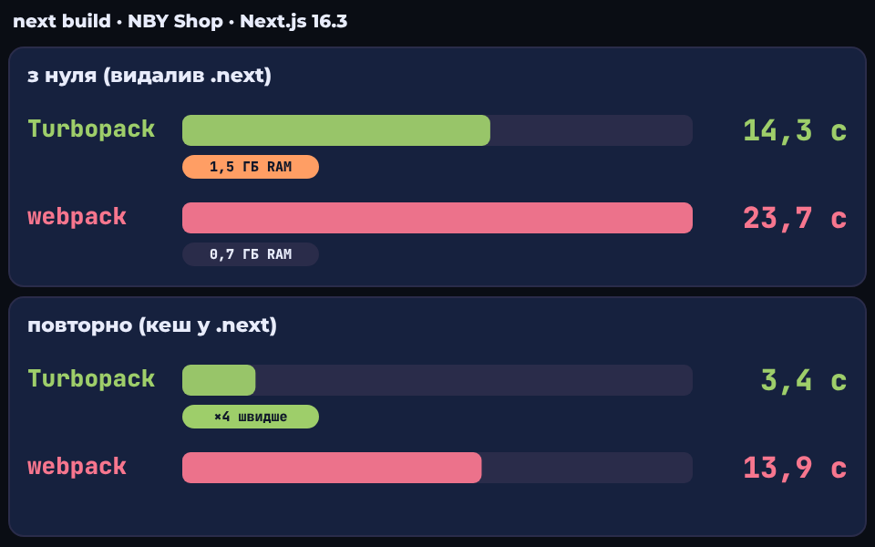

# BuildTime — next build: Turbopack проти webpack на NBY Shop

Пост #246 @nby.frontend. Замір 19.11.2026: NBY Shop (Next.js 16.3.5, 26 сторінок при збірці, Prisma + Postgres, Tailwind 4), Node 22.23, Linux, 2 ядра.



## Результат (медіана з 3, збирачі чергуються)

| | Turbopack (`next build`) | webpack (`next build --webpack`) |
|---|---|---|
| **з нуля** (без `.next`) | **14,3 с** (компіляція 8,5 с) | 23,7 с (компіляція 9,9 с) |
| **повторно** (кеш у `.next`) | **3,4 с** (компіляція 0,2 с) | 13,9 с (компіляція 2,3 с) |
| пік пам'яті, з нуля | 1,5 ГБ | **0,7 ГБ** |
| клієнтський JS (`.next/static/chunks`, gzip) | **317 KB** (20 файлів) | 357 KB (35 файлів) |

Окрема перевірка: якщо після збірки лишити в `.next` **лише `.next/cache`**, повторна збірка така сама — 3,5 с (Turbopack) і 13,9 с (webpack). Тобто в CI досить кешувати `.next/cache`.

Усі прогони — у `results.json` (`runsRaw`).

## Як повторити

```bash
cd my-next-app && npm ci          # проєкт має збиратись: БД, змінні середовища тощо
cd ../BuildTime
node scripts/bench.mjs ../my-next-app 3   # → results.json
```

Скрипт для кожного прогону: видаляє `.next` → `next build` (cold) → `next build` ще раз (warm). Пам'ять — сума RSS усього дерева процесів, опитування кожні 100 мс.

## Обмеження

Одна машина з 2 ядрами: на інших машинах співвідношення може бути іншим. Проєкт невеликий (~70 файлів коду). Turbopack не виконує власну функцію `webpack()` з `next.config` — якщо вона є, її доведеться переносити.
