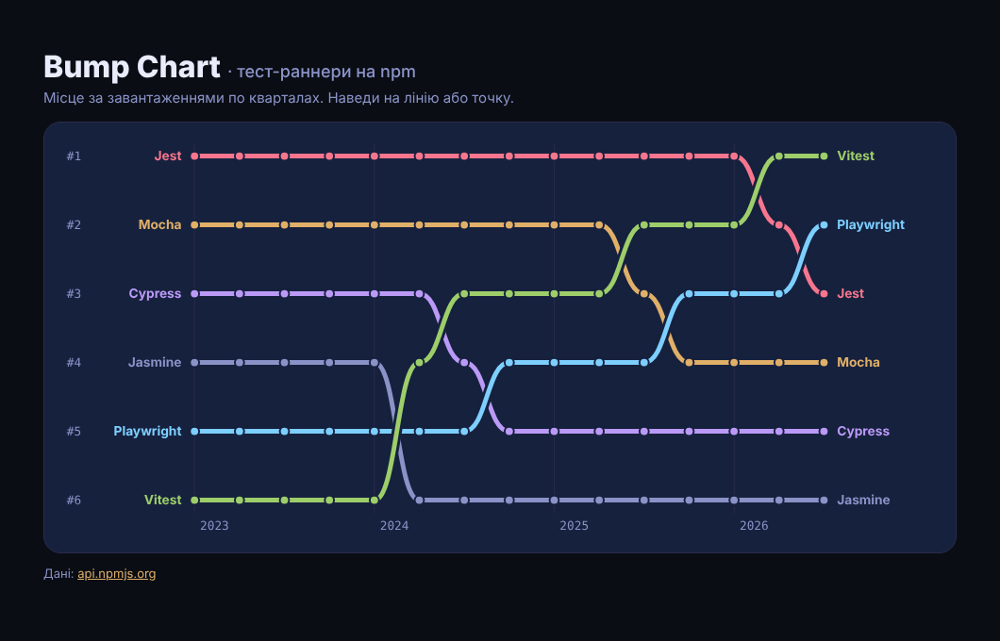

# BumpChart

Bump chart на D3: місце шести тест-раннерів - **Jest**, **Vitest**, **Mocha**, **Cypress**, **Playwright** і **Jasmine** - за завантаженнями з npm по кварталах з 2023-го. Наведи на лінію - решта тьмяніє, на точку - тултип з місцем і справжніми завантаженнями.

> Пост [@nby.frontend](https://instagram.com/nby.frontend) #219 · ключ `BumpChart`



## Запуск

```bash
npm i && npm run dev
```

Оновити дані до останнього повного кварталу:

```bash
npm run data   # node scripts/fetch-npm.mjs > src/data.js
```

## Як це працює

1. **Місця** (`src/main.js`) - `d3.group(rows, d => d.q)` групує по кварталах, `d3.sort(list, d => -d.n)` сортує за завантаженнями, індекс + 1 = місце.
2. **Шкали** - дві `d3.scalePoint()`: квартали по X, місця 1…6 по Y. Відстань між рядками однакова, бо важливе лише місце.
3. **Лінії** - `d3.line()` з `d3.curveBumpX`: між сусідніми кварталами крива з горизонтальними дотичними, тому зміна місця виглядає як плавна «сходинка». Під кольоровою лінією - товстіша «halo» кольору фону, щоб перетини читались.
4. **Фокус** - `pointerenter` на групі лінії додає `.dim` усім іншим (`classed('dim', p => p !== s)`), CSS-перехід робить решту.
5. **Тултип** - рейтинг ховає масштаб, тому біля точки показуються справжні завантаження на тиждень.

## Дані

`scripts/fetch-npm.mjs` бере `api.npmjs.org/downloads/range/...` шматками по 18 місяців, сумує по кварталах і рахує середнє на тиждень: `сума / днів × 7`. Незавершений поточний квартал не береться.

Завантаження з npm - це не люди: туди входять CI-збірки й залежності інших пакетів. Порівнюй тренди, а не абсолютні числа.

## Файли

- `src/main.js` - місця, шкали, лінії, фокус і тултип
- `src/data.js` - згенеровані дані
- `scripts/fetch-npm.mjs` - збір даних з npm (Node 18+, без залежностей)
- `src/style.css` - Tokyo Night стилі

---

EN: D3 bump chart of six JS test runners ranked by quarterly npm downloads since 2023 (Vitest goes from 6th to 1st). Hover a line to focus it, hover a point for real numbers. `npm i && npm run dev`, refresh data with `npm run data`.
