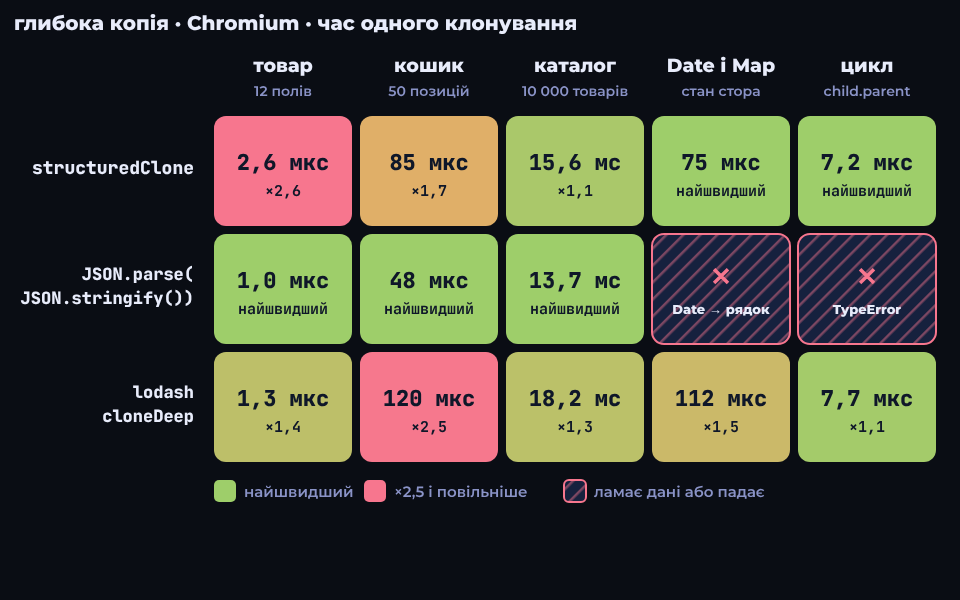

# DeepCloneRace — structuredClone, JSON і lodash cloneDeep

Пост #253 @nby.frontend (тема з резерву: прохань під #249 не було). Замір 27.11.2026: Chromium 153, Node 22.23, lodash-es 4.18.1, Linux, 2 ядра.



## Що міряли

`src/cases.js` — п'ять форм даних NBY Shop: товар, кошик на 50 позицій, каталог на 10 000 товарів, стан стора з `Date`, `Map` і `Set`, дерево з посиланням на батька (цикл). `src/methods.js` — три способи й перевірка, чи клон правильний. `src/measure.js` — медіана 15 вимірів-пачок по ~40 мс після прогріву.

Кожна пара «спосіб × дані» — окрема сторінка Chromium і окремий процес Node, 5 разів, медіана.

## Результат (час одного клонування)

### Chromium 153

| дані | structuredClone | JSON.parse(JSON.stringify()) | lodash cloneDeep |
|---|---|---|---|
| товар (12 полів) | 2,6 мкс | 1,0 мкс | 1,3 мкс |
| кошик (50 позицій) | 84,6 мкс | 48,4 мкс | 119,7 мкс |
| каталог (10 000) | 15,6 мс | 13,7 мс | 18,2 мс |
| Date + Map + Set | 74,5 мкс | 1,0 мкс ✗ (клон зламаний) | 112,3 мкс |
| дерево з циклом | 7,2 мкс | ✗ TypeError | 7,7 мкс |

### Node 22.23

| дані | structuredClone | JSON.parse(JSON.stringify()) | lodash cloneDeep |
|---|---|---|---|
| товар (12 полів) | 1,5 мкс | 1,5 мкс | 1,6 мкс |
| кошик (50 позицій) | 66,5 мкс | 65,5 мкс | 140,8 мкс |
| каталог (10 000) | 11,5 мс | 13,2 мс | 23,7 мс |
| Date + Map + Set | 58,3 мкс | 0,9 мкс ✗ (клон зламаний) | 146,6 мкс |
| дерево з циклом | 5,8 мкс | ✗ TypeError | 8,7 мкс |

✗ (клон зламаний) — JSON перетворює `Date` на рядок, а `Map` і `Set` — на `{}`; TypeError — «Converting circular structure to JSON».

`lodash-es/cloneDeep` у браузерному бандлі (esbuild --minify): 14,2 KB, gzip 5,0 KB.

## Висновок

- За замовчуванням — `structuredClone`: правильний на всіх формах даних, вбудований у браузер і Node.
- `JSON.parse(JSON.stringify())` швидший на простих даних, але лише коли там рядки, числа, масиви й звичайні об'єкти.
- `cloneDeep` — правильний, але найповільніший на кошику і додає вагу в бандл.

Обмеження: `structuredClone` не копіює функції й класові прототипи (екземпляр класу стає звичайним об'єктом) — у тест такі дані не входили.

## Запуск

```bash
npm i
npm run bench     # → results.json
```
