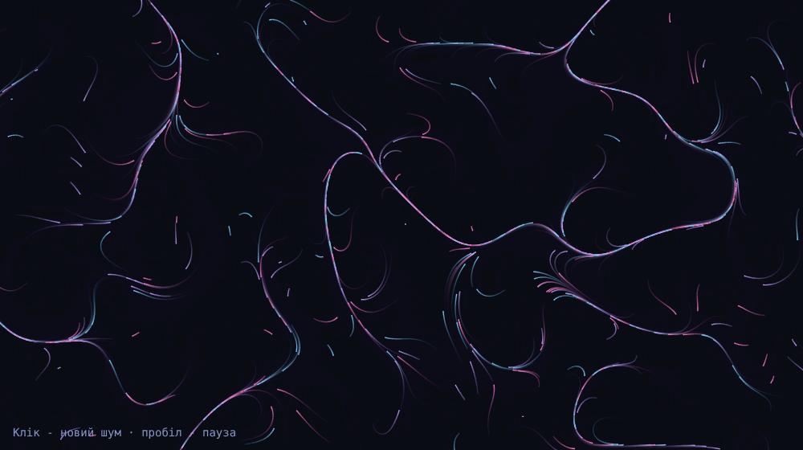

# Flow Field

Частинки течуть за полем кутів із шуму — класика creative coding на чистому `<canvas>` + [simplex-noise](https://github.com/jwagner/simplex-noise.js).
Клік — новий шум, пробіл — пауза. `prefers-reduced-motion` показує статичну картинку замість анімації.

> Пост [@nby.frontend](https://instagram.com/nby.frontend) #213 · ключ `FlowField`



## Запуск

```bash
npm i && npm run dev
```

## Як це працює

1. **Поле** (`src/field.js`) — `noise(x * scale, y * scale, t * drift)` дає число від -1 до 1; × π × turns = кут. Третій вимір (час) змушує поле повільно дихати.
2. **Крок** — щокадру кожна частинка зсувається на `cos(a), sin(a)` × швидкість і малює відрізок від старої позиції до нової.
3. **Сліди** — замість `clearRect` canvas заливається фоном з прозорістю `0.08`: старі лінії тьмяніють самі. Менше число — довші хвости.
4. **Переродження** (`src/particles.js`) — частинка, що вилетіла за край або прожила `life` кадрів, народжується в новій випадковій точці.

Налаштування для експериментів: `scale` (розмір вихорів), `turns` (наскільки закручене поле), `SPEED`, прозорість фону.

## Файли

- `src/field.js` — поле кутів
- `src/particles.js` — народження / смерть частинок
- `src/main.js` — цикл малювання, resize, клік, пауза

---

EN: Canvas flow field — particles follow a simplex-noise angle field, trails via translucent background fill. `npm i && npm run dev`.
