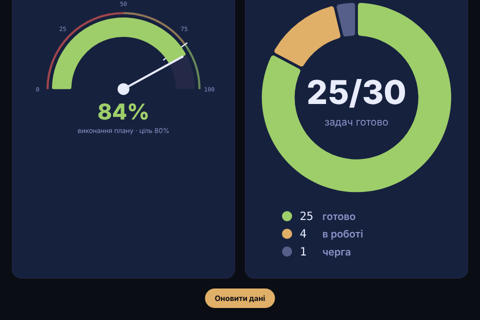

# GaugeKpi

Два KPI-віджети для дашборда на D3: напівкруглий **gauge** (спідометр зі стрілкою, зонами й міткою цілі) і **donut** (з чого складається ціле). Дані оновлюються кожні 3 с — стрілка, дуги й числа плавно перетікають від старих значень до нових.

> Пост [@nby.frontend](https://instagram.com/nby.frontend) #216 · ключ `GaugeKpi`



## Запуск

```bash
npm i && npm run dev
```

## Як це працює

1. **Gauge** (`src/gauge.js`) — `d3.scaleLinear().domain([0, 100]).range([-π/2, π/2])` перетворює відсоток на кут, `d3.arc().startAngle(-π/2)` малює дугу до `endAngle(angle(value))`.
2. **Donut** (`src/donut.js`) — `d3.pie().sort(null).padAngle(...)` рахує кути сегментів, той самий `d3.arc()` з `innerRadius` малює кільце.
3. **Оновлення** — `attrTween` інтерполює від попереднього значення до нового. Попереднє зберігається прямо на DOM-вузлі (`node()._v` / `this._current`), тому кожна анімація стартує з місця, де зупинилась попередня.
4. **Число** — `textTween` + `d3.interpolate` → count-up без окремого таймера.
5. `prefers-reduced-motion` вимикає автооновлення.

Підстав свої дані в `randomData()` у `src/main.js` (наприклад, `fetch` до свого API).

## Файли

- `src/gauge.js` — спідометр
- `src/donut.js` — бублик з легендою
- `src/main.js` — дані й таймер
- `src/style.css` — Tokyo Night стилі

---

EN: D3 KPI widgets — semicircle gauge with needle/zones/target and a donut, both animating from previous values via attrTween. `npm i && npm run dev`.
