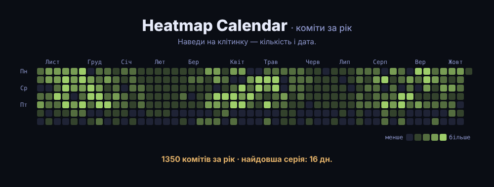

# Heatmap Calendar

Heatmap-календар на D3 «як у GitHub»: колонка — тиждень, рядок — день тижня, колір — кількість за день.
Наведи на клітинку — кількість і дата. Під календарем — загальна сума і найдовша серія.
Дані — умовні коміти за 52 тижні (`src/data.js`, детермінований `d3.randomLcg`), заміни на свої `[{ date, count }]`.

> Пост [@nby.frontend](https://instagram.com/nby.frontend) #211 · ключ `HeatmapCalendar`



## Запуск

```bash
npm i && npm run dev
```

## Як це працює

1. **Колонка** — `d3.timeMonday.count(start, date)`: скільки понеділків минуло від старту.
2. **Рядок** — `(date.getDay() + 6) % 7`: у JS неділя = 0, зсув робить понеділок першим.
3. **Колір** — `d3.scaleThreshold().domain([1, 4, 7, 10])`: 5 фіксованих відтінків, один день-рекорд не з'їдає контраст.
4. **Місяці** — підпис над тижнем, у якому припадає 1-ше число (`d3.timeMonths`).

## Файли

- `src/data.js` — генерація умовних даних
- `src/heatmap.js` — розмітка, клітинки, підписи, легенда, `longestStreak()`
- `src/main.js` — точка входу
- `src/style.css` — Tokyo Night стилі

---

EN: GitHub-style D3 heatmap calendar — week columns, weekday rows, threshold color scale. `npm i && npm run dev`.
