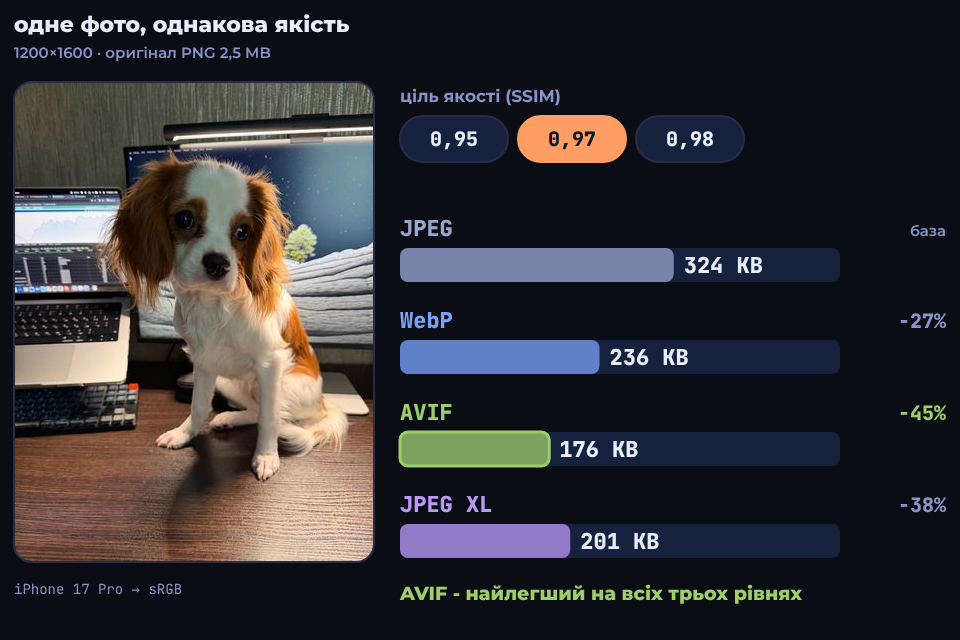

# ImageFormats

Одне фото в JPEG, WebP, AVIF і JPEG XL: скільки важить **однакова якість**. Порівнювати однаковий `quality` між форматами нечесно, бо в кожного кодека ця цифра означає різне. Тому для кожного формату підбирається найменший файл, що досягає того самого SSIM.

> Пост [@nby.frontend](https://instagram.com/nby.frontend) #236 · папка `ImageFormats`



## Запуск

```bash
npm i
pip install numpy pillow scikit-image
npm run bench      # encode.mjs → out/ (4 формати × 34 якості), ssim.py → results.json
```

## Методика

- **Фото:** мій знімок з iPhone 17 Pro, експорт JPEG максимальної якості. Display P3 переведено в sRGB, зменшено до 1200×1600 (Lanczos). Результат — [`source.png`](source.png) (2,5 MB, без EXIF).
- **Кодеки:** jSquash — ті самі WASM-збірки, що в Squoosh: mozjpeg, libwebp, libavif (aom, speed 6), libjxl (effort 7). Налаштування за замовчуванням, змінюється лише `quality` (30–96, крок 2).
- **Якість:** SSIM на яскравості (Y, BT.601), гаусове вікно σ = 1,5 (`skimage.metrics.structural_similarity`). Для цілей 0,95 / 0,97 / 0,98 береться найменший файл, у якого SSIM ≥ цілі.

## Результат (09.11.2026)

| SSIM | JPEG | WebP | AVIF | JPEG XL |
|---|---|---|---|---|
| 0,95 | 190 KB (q72) | 153 KB (−19%) | **120 KB (−37%)** | 128 KB (−33%) |
| 0,97 | 324 KB (q86) | 236 KB (−27%) | **176 KB (−45%)** | 201 KB (−38%) |
| 0,98 | 504 KB (q92) | 356 KB (−29%) | **259 KB (−49%)** | 270 KB (−46%) |

Час кодування на 0,97 (WASM, 1 потік): JPEG 0,3 с, WebP 0,4 с, AVIF 2,2 с, JPEG XL 2,8 с.

Файли для 0,97 лежать у [`picks/`](picks/). Відкрий їх поруч і порівняй на око.

## Висновок

- На цьому фото AVIF найлегший на всіх трьох рівнях якості, на 0,97 він −45% від JPEG.
- JPEG XL на високій якості майже наздоганяє AVIF (270 проти 259 KB). Chrome декодує JPEG XL з версії 155 ([Chrome for Developers, 06.10.2026](https://developer.chrome.com/blog/jpeg-xl-in-chrome)).
- Для сайту — `<picture>`: AVIF першим, WebP і JPEG як запасні.
- SSIM — лише одна метрика, і вона дивиться тільки на яскравість. Інші метрики (SSIMULACRA2, Butteraugli) і інші фото можуть дати інший порядок. Міряй на своїх картинках.

## Файли

- `scripts/encode.mjs` — кодування й декодування (jSquash), `out/encode.json`
- `scripts/ssim.py` — SSIM і підбір під ціль, `results.json`
- `source.png`, `picks/`, `results.json`

---

EN: One photo (1200×1600) encoded to JPEG, WebP, AVIF and JPEG XL with Squoosh codecs, picking the smallest file that reaches the same SSIM. At SSIM 0.97: JPEG 324 KB, WebP 236, JPEG XL 201, AVIF 176 (−45%). AVIF wins at all three levels; JPEG XL nearly catches up at 0.98. `npm i && npm run bench`.
