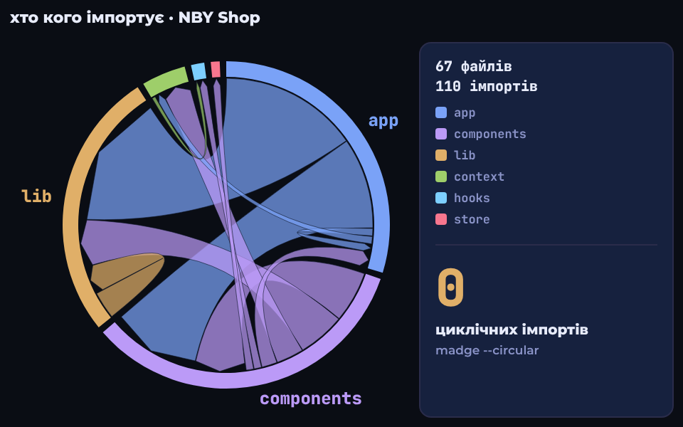
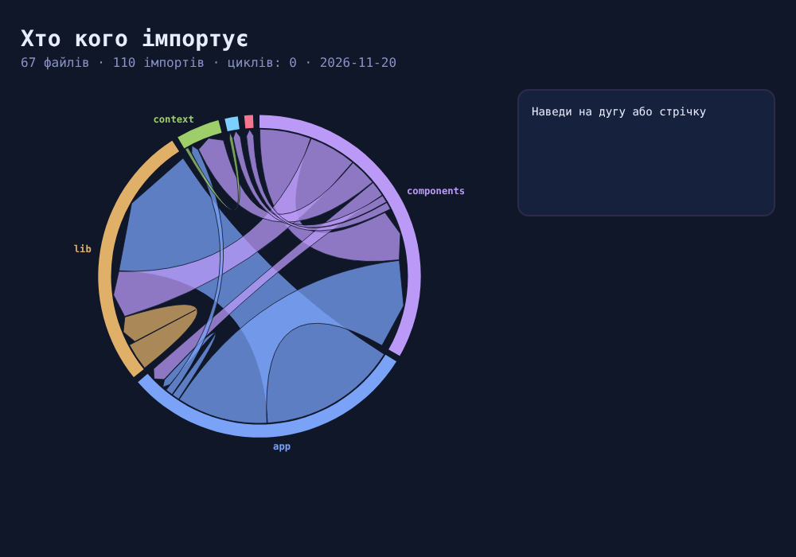

# ImportChord — хто кого імпортує в NBY Shop

Пост #247 @nby.frontend (візуал-каталог №4). Chord diagram імпортів між папками Next.js-проєкту: дані з `madge`, діаграма — `d3.chordDirected` + `d3.ribbonArrow`.



## Запуск

```bash
npm i
npm run graph -- ../ShopProject   # → src/data.json (за замовчуванням папки app components lib hooks store context)
npm run dev                        # наведи на дугу або стрічку - побачиш, хто кого імпортує
```

Інші папки: `npm run graph -- ../my-app src/features src/shared src/pages`. Група — перша частина шляху файлу.



## Що видно на NBY Shop (20.11.2026, Next.js 16.3)

67 файлів, 110 імпортів між ними, **циклів — 0** (`madge --circular`).

| звідки ↓ / куди → | app | components | lib | context | hooks | store |
|---|---|---|---|---|---|---|
| **app** | 2 | 23 | **35** | 2 | 0 | 0 |
| **components** | **4** | 13 | 12 | 7 | 2 | 2 |
| **lib** | 0 | 0 | 7 | 0 | 0 | 0 |
| **context** | 0 | 0 | 0 | 0 | 1 | 0 |

- `app → lib` (35) — найтовща стрічка: сторінки беруть дані й логіку з `lib`, а не з компонентів.
- `components → app` (4) — єдині «зворотні» імпорти, і всі чотири — server actions (`app/*/actions.ts`) у клієнтських формах. Для App Router це нормально.
- `lib` не імпортує нічого, крім `lib` — чистий нижній шар.
- Найчастіше імпортований файл — `lib/prisma.ts` (13 разів).

## Обмеження

Рахуються лише імпорти між файлами проєкту (`node_modules` — ні) і лише `.ts`/`.tsx`. Тип-імпорти madge рахує так само, як звичайні.
