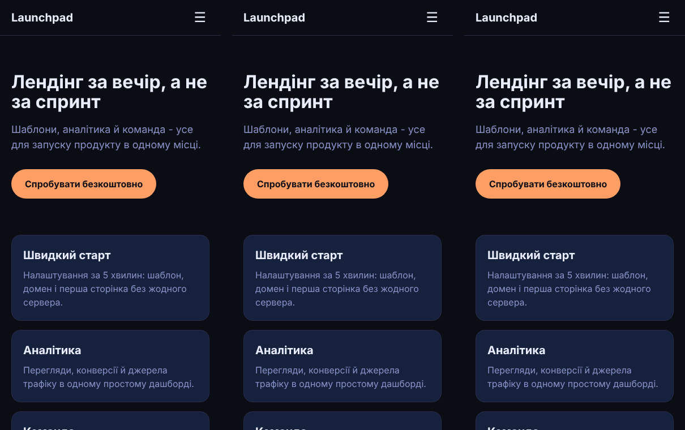

# LoadingWaterfall

Один і той самий лендінг (шапка з мобільним меню, hero, три картки, FAQ-акордеон), зібраний трьома способами:

- `next/` — **Next.js 16.4** App Router, `output: "export"` (статичні файли, меню й FAQ — `"use client"`)
- `vite-rr/` — **Vite 8.3 + React Router 8.5**, класична SPA (`<div id="root">` + `createBrowserRouter`)
- `astro/` — **Astro 7.4** + `@astrojs/react`: сторінка — статичний HTML, меню `client:load`, FAQ `client:visible`

Компоненти й стилі однакові (`shared/`), різниться лише те, як фреймворк віддає сторінку.

> Пост [@nby.frontend](https://instagram.com/nby.frontend) #226 · папка `LoadingWaterfall`



## Результат (29.10.2026)

Lighthouse 13.6, mobile, throttling «devtools» (повільний 4G + 4× CPU), headless Chromium, медіана з 3 запусків (`results.json`):

| | LCP (контент видно) | TBT | JS | запитів JS | Performance |
|---|---|---|---|---|---|
| Next.js (static export) | 1,27 с | 131 ms | 134 KB | 6 | 99 |
| Vite + React Router (SPA) | 1,91 с | 0 ms | 97 KB | 1 | 98 |
| Astro (React-острови) | 0,67 с | 0 ms | 69 KB | 4 | 100 |

Чому так:

- **SPA** віддає порожній `<div id="root">` — поки не завантажиться й не виконається весь JS, на екрані нічого немає.
- **Next.js** віддає готовий HTML (контент видно раніше), але потім вантажить рантайм React + RSC-payload і гідратує — звідси 134 KB і 131 ms блокування потоку.
- **Astro** віддає HTML і JS тільки для двох островів. FAQ із `client:visible` гідратується, лише коли доскролиш до нього (перший клік до гідратації не спрацює — це компроміс).

## Запуск

```bash
# кожна збірка - окремий проєкт
cd next && npm i && npm run build      # → next/out
cd vite-rr && npm i && npm run build   # → vite-rr/dist
cd astro && npm i && npm run build     # → astro/dist (Node 22.23.4+)

# однаковий статичний сервер з gzip для всіх трьох
node scripts/serve.mjs next/out 4401
node scripts/serve.mjs vite-rr/dist 4402
node scripts/serve.mjs astro/dist 4403

# заміри
npm i lighthouse chrome-launcher && node scripts/lighthouse.mjs
```

`shared/` — оригінали спільних файлів; у кожен проєкт вони скопійовані (Next.js ще й з `"use client"` у `Faq.jsx` і `Menu.jsx`), щоб кожна збірка була самодостатньою.

## Обмеження заміру

Лабораторні метрики на локальному сервері з емуляцією мережі й CPU — для порівняння збірок між собою, а не обіцянка цифр на проді. Один простий лендінг: у великому застосунку різниця інша.

---

EN: The same landing page built with Next.js (static export), Vite + React Router (SPA) and Astro (React islands), measured with Lighthouse mobile (slow 4G + 4x CPU). LCP: Astro 0.67 s, Next.js 1.27 s, SPA 1.91 s; JS 69 / 134 / 97 KB.
