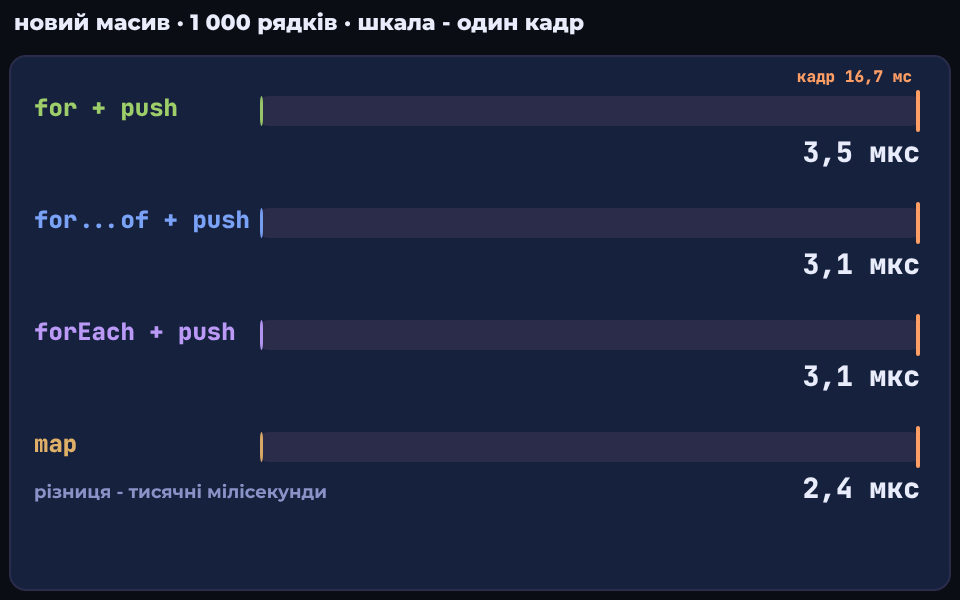

# LoopRace — for, for...of, forEach, reduce, map на 1 000 000 елементів

Пост #243 @nby.frontend. Замір 16.11.2026: Chromium 153 (Playwright) і Node 22.23, Linux, 2 ядра.



## Що міряємо

Дані — масив рядків кошика `{ price, qty }` (`scripts/cases.js`). Дві задачі:

- **sum** — сума `price * qty`: `for`, `for...of`, `forEach`, `reduce`;
- **totals** — новий масив `price * qty`: `for + push`, `for...of + push`, `forEach + push`, `map`.

`scripts/measure.js`: `cold` — перший виклик; `hot` — медіана 30 вимірів після 20 прогрівів. Для 1 000 елементів кожен вимір — пачка з 1 000 викликів, поділена на 1 000 (у браузері таймер грубий). Кожен варіант запускається в **окремому** процесі Node / окремій сторінці Chromium, щоб JIT не оптимізував код під сусідів; 5 запусків, медіана.

## Результати (hot, мс)

| Задача | Варіант | Chromium 153 | Node 22 |
|---|---|---|---|
| сума, 1 000 000 | for | **1,6** | **2,5** |
| | for...of | 10,0 | 9,0 |
| | reduce | 11,9 | 8,9 |
| | forEach | 12,6 | 8,6 |
| новий масив, 1 000 000 | for + push | 10,4 | 22,5 |
| | map | 11,2 | **12,0** |
| | forEach + push | 13,3 | 26,0 |
| | for...of + push | 13,9 | 28,7 |
| новий масив, 1 000 | for + push | 0,0035 | 0,0035 |
| | for...of + push | 0,0031 | 0,0035 |
| | forEach + push | 0,0031 | 0,0034 |
| | map | 0,0024 | 0,0020 |

Усі числа, включно з `cold` і задачею «сума» на 1 000, — у `results.json`.

## Висновок

- У гарячій точці на мільйонах елементів простий `for` швидший у 4–8 разів.
- Для нового масиву `map` не гірший за `for + push`, а в Node — майже вдвічі швидший (одразу виділяє масив потрібної довжини).
- На 1 000 елементів усі варіанти — 1–4 мкс. Кадр при 60 fps — 16,7 мс. Тут обирай те, що краще читається.

## Запуск

```bash
npm i -D playwright && npx playwright install chromium
node scripts/bench.mjs            # 5 запусків → results.json (~5 хв)
node scripts/one.mjs sum for      # один варіант у Node
```

## Обмеження

Мікробенчмарк: числа залежать від версії V8, форми даних і того, що ще робить сторінка. Слабка машина (2 ядра). Firefox і Safari не міряли.
