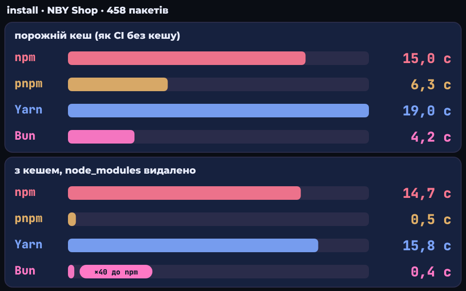

# PackageManagers — install NBY Shop: npm, pnpm, Yarn, Bun

Пост #249 @nby.frontend. Замір 23.11.2026: NBY Shop (Next.js 16, 458 пакетів), Node 22.23, Linux, 2 ядра, медіана з 3.



## Результат

| | порожній кеш | з кешем (node_modules видалено) | node_modules | кеш |
|---|---|---|---|---|
| npm 10.9.9 (`npm ci`) | 15,0 с | 14,7 с | 1 009 MB | 292 MB |
| pnpm 12.21.0 | 6,3 с | **0,5 с** | 769 MB | 974 MB |
| Yarn 4.19.0 (node-modules) | 19,0 с | 15,8 с | 849 MB | 743 MB |
| Bun 1.4.5 | **4,2 с** | **0,4 с** | 775 MB | 779 MB |

Усі прогони — у `results.json` (`raw`). Порожній кеш залежить від мережі: у Yarn прогони були 17,5–25,9 с.

## Як міряли

`scripts/bench.mjs` для кожного менеджера:
1. окрема копія проєкту без `node_modules` і чужих lockfile;
2. lockfile генерується один раз до замірів (як закомічений у репо);
3. **cold**: видалити кеш і `node_modules` → install з frozen-lockfile;
4. **warm**: видалити лише `node_modules` → install ще раз.

Усі — з `--ignore-scripts` (postinstall не запускається), Yarn 4 — з `nodeLinker: node-modules` (за замовчуванням Yarn 4 ставить PnP без `node_modules`, і це інша модель). Кеш кожного менеджера — в окремій папці.

```bash
node scripts/bench.mjs ../ShopProject 3 /tmp/pm-bench
```

Потрібні `npm`, `pnpm`, `bun` у PATH і `corepack` (для `yarn@4.19.0`).

## Чому так

pnpm і Bun з кешем ставлять файли через hardlink (див. кількість посилань на файл: `stat -c %h node_modules/next/package.json` → 2), тому `node_modules` з'являється за пів секунди. npm і Yarn копіюють/розпаковують пакети з кешу щоразу.

## Обмеження

Кожен менеджер резолвить залежності сам, тож версії в lockfile можуть трохи відрізнятись (у межах діапазонів з `package.json`). Одна машина, одна мережа; на macOS і Windows числа будуть іншими.
