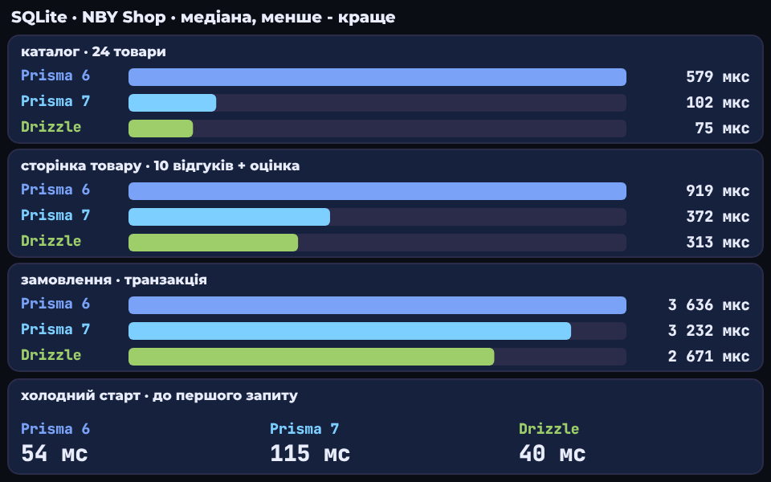

# PrismaVsDrizzle — Prisma 6, Prisma 7 і Drizzle на SQLite-базі NBY Shop

Пост #252 @nby.frontend. Замір 26.11.2026: Prisma 6.19.3 (як у магазині, Rust-рушій), Prisma 7.10.1 + `@prisma/adapter-better-sqlite3`, Drizzle 0.45.4 + better-sqlite3 13.2.0; Node 22.23, Linux, 2 ядра.



## Що міряли

Схема магазину (`prisma6/schema.prisma`) перенесена на SQLite і наповнена `scripts/seed.mjs`: 2 000 товарів, 40 000 відгуків, 500 користувачів, 2 000 замовлень. Три запити магазину — однаково на всіх ORM (`app/`):

1. **каталог** — 24 опубліковані товари, нові першими;
2. **сторінка товару** — товар за slug + 10 останніх відгуків + середня оцінка;
3. **замовлення** — наступний номер + замовлення + 2 позиції в одній транзакції.

Код запитів Prisma однаковий для 6 і 7 (`queries-prisma.ts`), відрізняється лише створення клієнта.

## Результат (медіана з 5 процесів; у кожному — медіана 2 000 запитів)

| | Prisma 6 | Prisma 7 | Drizzle |
|---|---|---|---|
| каталог | 579 мкс | 102 мкс | **75 мкс** |
| сторінка товару | 919 мкс | 372 мкс | **313 мкс** |
| замовлення (транзакція) | 3 636 мкс | 3 232 мкс | **2 671 мкс** |
| холодний старт, бандл esbuild | 53,9 мс | 114,8 мс | **40,2 мс** |
| холодний старт, без бандла | **56,5 мс** | 129,5 мс | 234,9 мс |
| `node_modules` для роботи | 93 MB | 113 MB | **44 MB** |

Холодний старт — від старту процесу Node до результату першого запиту. Без бандла Drizzle повільний через завантаження 448 ESM-файлів `drizzle-orm`; у бандлі (як у Next.js чи serverless) — найшвидший.

## Що змінюється при переході

- **Prisma 6 → 7:** генератор `prisma-client` з `output`, `prisma.config.ts` замість `url` у схемі, клієнт з адаптером `new PrismaClient({ adapter: new PrismaBetterSqlite3({ url }) })`. Запити — без змін.
- **Prisma → Drizzle:** схема переписується вручну (`app/drizzle-schema.ts`, 64 рядки), зв'язки — окремо; вкладене `items: { create: [...] }` стає двома `insert`; транзакція better-sqlite3 синхронна (без `await` усередині); міграції — через drizzle-kit.
- **SQLite у Prisma:** `@default(autoincrement())` не можна на полі, що не є id (`Order.orderSeq` у магазині) — номер рахується в транзакції.

## Запуск

```bash
# у трьох папках поставити залежності: prisma@6.19.3 @prisma/client@6.19.3 | prisma@7.10.1 @prisma/client@7.10.1 @prisma/adapter-better-sqlite3 better-sqlite3 | drizzle-orm better-sqlite3
npx prisma db push && node scripts/seed.mjs          # база в prisma6/
# app/run.ts - шаблон: замініть __ORM__ на "./queries-drizzle" | "./queries-prisma6" | "./queries-prisma7",
# зберіть esbuild-ом у папку ORM як bench.mjs (--packages=external) і bench-bundled.mjs (зовнішні лише better-sqlite3 / @prisma/client 6), далі:
node scripts/bench-all.mjs <робоча папка> <shop.db> 5  # → results.json
```
