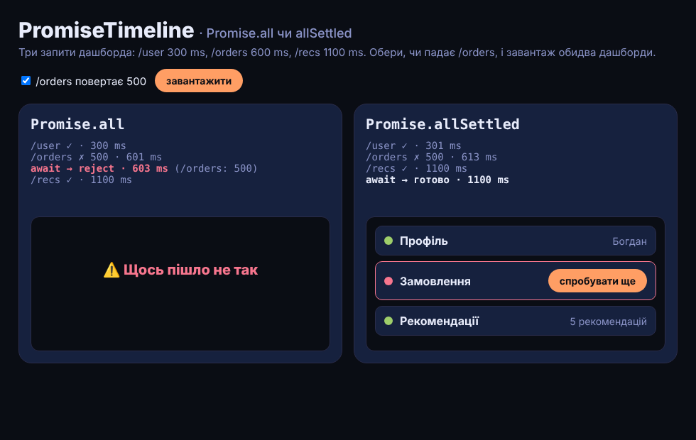

# PromiseTimeline

Один дашборд, три запити, один із них падає — і два способи їх дочекатися: **Promise.all** і **Promise.allSettled**. Лог показує, коли прийшов кожен запит і коли `await` повернув керування, а нижче — що бачить користувач.

> Пост [@nby.frontend](https://instagram.com/nby.frontend) #229 · папка `PromiseTimeline`



## Запуск

```bash
npm i && npm run dev
```

Галочка «/orders повертає 500» вмикає/вимикає відмову, «завантажити» перезапускає обидва дашборди. У варіанті з `allSettled` кнопка «спробувати ще» повторює лише запит, що впав.

## Що видно (мок-API: /user 300 ms, /orders 600 ms → 500, /recs 1100 ms)

| | Promise.all | Promise.allSettled |
|---|---|---|
| `await` повертає керування | ~600 ms, `reject` | ~1100 ms, завжди `fulfilled` |
| на екрані | «Щось пішло не так», 0 з 3 | 2 з 3 + картка помилки |
| /recs | однаково довантажується до 1100 ms — його ніхто не скасував | показується |

## Як вибрати

- **Promise.all** — коли дані мають сенс лише разом (товар + ціна + наявність). Швидко падає — і це добре.
- **Promise.allSettled** — коли частини незалежні (віджети дашборда). Кожен результат — `{ status: "fulfilled", value }` або `{ status: "rejected", reason }`.
- **Promise.any** — коли потрібен перший успішний (дзеркала, CDN). **Promise.race** — перший завершений, будь-як (таймаут).
- Жоден із них **не скасовує** інші запити. Для цього — `AbortController`: передай `signal` у кожен `fetch` і виклич `abort()` у `catch`.

## Файли

- `src/api.js` — мок-API із затримками й відмовою `/orders`
- `src/main.js` — `loadAll()` і `loadSettled()`, повтор одного запиту
- `src/style.css` — Tokyo Night стилі

---

EN: One dashboard, three requests, one fails. Promise.all rejects at ~600 ms and shows nothing (0/3) while /recs keeps loading; Promise.allSettled resolves at ~1100 ms with 2/3 widgets and a per-widget retry. `npm i && npm run dev`.
