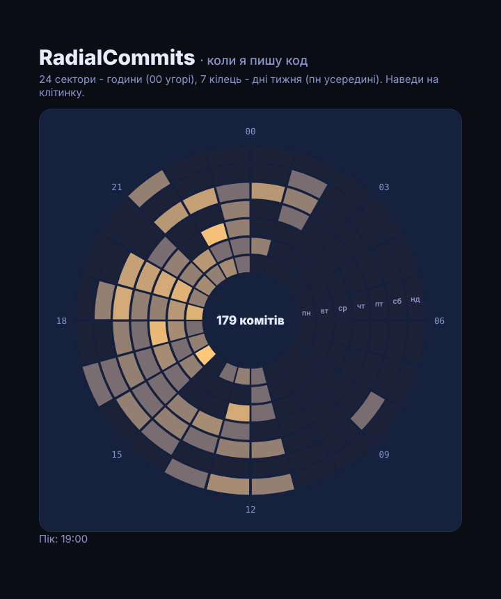

# RadialCommits

Радіальний heatmap комітів на D3: 24 сектори — години доби (00 угорі, як на циферблаті), 7 кілець — дні тижня (пн усередині, нд зовні). Колір — кількість комітів. Наведи на клітинку — день, година й число.

> Пост [@nby.frontend](https://instagram.com/nby.frontend) #225 · папка `RadialCommits`



## Запуск

```bash
npm i && npm run dev
```

## Зроби для своїх репо

```bash
node scripts/commits.mjs ../my-repo ../another-repo > src/data.js
# інший часовий пояс або лише твої коміти:
TZ_NAME=Europe/Warsaw AUTHOR=me@example.com node scripts/commits.mjs ../my-repo > src/data.js
```

Скрипт бере лише дату автора (`git log --format=%aI`) і перераховує її в потрібний часовий пояс через `Intl.DateTimeFormat`. Назви репо, повідомлення й файли в `data.js` не потрапляють — тільки матриця 7 × 24.

## Як це працює

1. **Матриця** (`scripts/commits.mjs`) — кожен коміт → `[день тижня][година]`, у браузер іде вже готова сітка.
2. **Клітинки** (`src/main.js`) — один `d3.arc()` з функціями замість чисел: `innerRadius`/`outerRadius` від дня (кільце), `startAngle`/`endAngle` від години (сектор). Кут 0 у D3 — угорі, за годинниковою стрілкою, тож 00:00 опиняється там, де на циферблаті.
3. **Колір** — `d3.scaleSqrt()`: пара комітів уже помітна, а пік не «з'їдає» решту шкали. Нуль — окремий майже фоновий колір.
4. **Тултип** — `arc.centroid(d)` дає центр клітинки для позиції підказки.

## Дані в цьому прикладі

Публічні репо автора (Posts + DataToCanvas): 179 комітів, 10.03–27.10.2026, Europe/Kyiv. Пік — 19:00; 45% — після 19:00; 20% — між 22:00 і 02:00; з 02:00 до 08:00 — жодного.

## Файли

- `scripts/commits.mjs` — git log → `src/data.js` (Node 18+, без залежностей)
- `src/main.js` — d3.arc, кольорова шкала, підписи, тултип
- `src/style.css` — Tokyo Night стилі

---

EN: A D3 radial heatmap of git commits — 24 hour sectors × 7 weekday rings, built from `git log --format=%aI` (dates only, converted to your time zone). `node scripts/commits.mjs <repo...> > src/data.js`, then `npm i && npm run dev`.
