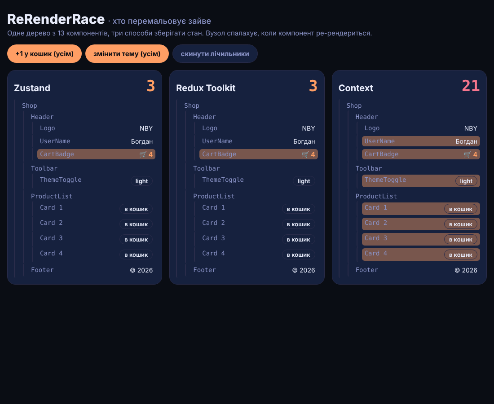

# ReRenderRace

Одне й те саме дерево магазину з 13 компонентів, зібране тричі: на **Zustand**, **Redux Toolkit** і **React Context**. Вузол спалахує, коли компонент ре-рендериться, а лічильник над колонкою показує, скільки ре-рендерів дала дія.

> Пост [@nby.frontend](https://instagram.com/nby.frontend) #220 · папка `ReRenderRace`



## Запуск

```bash
npm i && npm run build && npm run preview
```

Міряй у production-збірці (`build` + `preview`): у `dev` React додає перевірки, які спотворюють картину. `StrictMode` вимкнено навмисно — він рендерить двічі.

## Результат (22.10.2026)

React 19.3.1, zustand 5.0.16, @reduxjs/toolkit 2.13.0, react-redux 9.3.0:

| Дія | Zustand | Redux Toolkit | Context |
|---|---|---|---|
| +1 у кошик | 1 | 1 | 7 |
| зміна теми | 1 | 1 | 7 |
| 3 × «в кошик» | 3 | 3 | 21 |

У консолі браузера `__renders()` покаже, хто саме скільки разів ре-рендерився.

## Чому так

- **Context** (`src/stores/context.jsx`) — один провайдер з усім станом. Будь-яка зміна дає новий `value`, і React перемальовує **кожного** споживача `useContext(Ctx)`, навіть якщо той бере лише `addToCart`.
- **Zustand** (`src/stores/zustand.js`) — `useShop(s => s.count)`: компонент ре-рендериться, лише коли змінився саме його шматок (порівняння через `Object.is`).
- **Redux Toolkit** (`src/stores/redux.jsx`) — `useSelector(s => s.count)` працює так само; `useDispatch()` повертає стабільну функцію, тому картки з кнопкою «в кошик» не ре-рендеряться.

Як полагодити Context: розбити на кілька провайдерів (дані окремо від функцій, часті зміни окремо від рідкісних) або перейти на стор із селекторами.

## Як рахуються ре-рендери

`src/tracker.js`: кожен компонент викликає `useTrack(variant, name)`, а той у `useLayoutEffect` без залежностей (спрацьовує раз на кожен закомічений рендер) збільшує лічильник і перезапускає CSS-спалах. Панель лічильників читає їх через `useSyncExternalStore`, поза деревами, тож сама нічого не перемальовує.

## Файли

- `src/Tree.jsx` — фабрика дерева: однакові компоненти, різні хуки стану
- `src/stores/` — три сховища з однаковим станом `{ user, count, theme }`
- `src/tracker.js` — лічильник і спалах
- `src/App.jsx` — три колонки й кнопки «усім»

---

EN: The same 13-component shop tree built with Zustand, Redux Toolkit and React Context; nodes flash on re-render. One "add to cart" click: Zustand 1, RTK 1, Context 7 re-renders (production build, React 19.3). `npm i && npm run build && npm run preview`.
