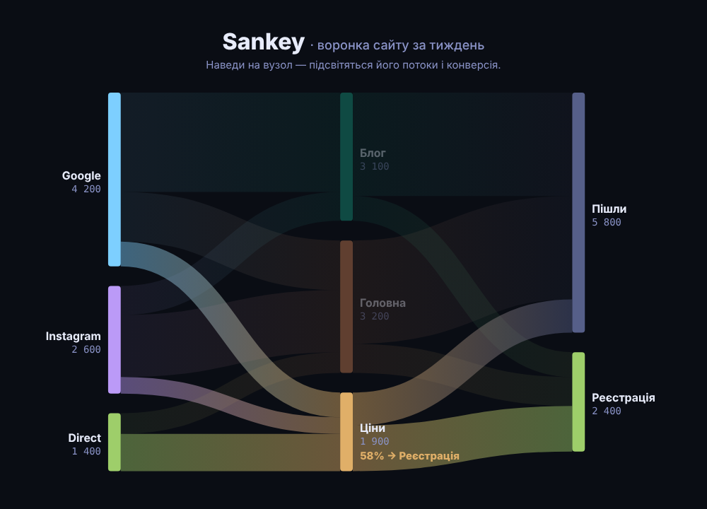

# Sankey

Sankey-діаграма на D3 + [d3-sankey](https://github.com/d3/d3-sankey): потоки між етапами, ширина стрічки = кількість.
Наведи на вузол — підсвітяться його потоки й найбільший вихідний потік у відсотках.
Дані — умовна воронка сайту (`src/data.js`), заміни на свої.

> Пост [@nby.frontend](https://instagram.com/nby.frontend) #209 · ключ `Sankey`



## Запуск

```bash
npm i && npm run dev
```

## Як це працює

1. Дані — `nodes` + `links` (`source`, `target`, `value`). З `nodeId(d => d.name)` у links пишемо назви, а не індекси.
2. `sankey()` рахує позиції вузлів (`x0/x1/y0/y1`) і товщину потоків (`width`). Він мутує вхідні об'єкти — тому `structuredClone(data)`.
3. `sankeyLinkHorizontal()` дає криву Безьє для потоку, а товщину задає `stroke-width = d.width`.
4. Градієнт на потоці (`gradientUnits="userSpaceOnUse"`) — від кольору джерела до кольору цілі.

## Файли

- `src/data.js` — дані
- `src/sankey.js` — розмітка, потоки, вузли, hover
- `src/main.js` — точка входу
- `src/style.css` — Tokyo Night стилі

---

EN: D3 Sankey diagram (d3-sankey) with gradient flows and hover highlight. `npm i && npm run dev`.
