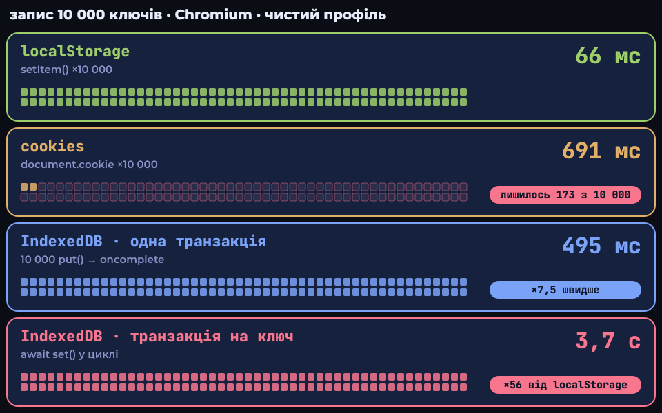

# StorageSpeed — запис 10 000 ключів: localStorage, IndexedDB, cookies

Пост #242 @nby.frontend. Замір 15.11.2026, Chromium 153 (headless, Playwright), Linux, 2 ядра, медіана з 3.



## Що міряємо

`public/index.html` записує 10 000 ключів (`k0…k9999`, значення — JSON товару ~60 байт) і читає їх назад:

| Варіант | Як пишемо | Запис | Головний потік зайнятий | Збережено |
|---|---|---|---|---|
| localStorage | `setItem()` ×10 000 | **66 мс** | 66 мс | 10 000 |
| cookies | `document.cookie = …` ×10 000 | 59 мс + **632 мс** перше читання | 691 мс | **173** |
| IndexedDB, одна транзакція | 10 000 `put()` → `oncomplete` | **495 мс** | 167 мс | 10 000 |
| IndexedDB, транзакція на ключ | `await` окремої транзакції на кожен ключ (як `set()` з idb-keyval у циклі) | **3 730 мс** | 668 мс | 10 000 |

Точні числа — у `results.json` (кожен запуск у `allWrite`).

## Що з цього видно

- Для дрібних ключів **localStorage найшвидший**: 66 мс на 10 000 записів. Але він синхронний — увесь цей час головний потік стоїть.
- **IndexedDB ключ за ключем — ×56 повільніше**: кожна транзакція чекає підтвердження. Одна транзакція на всі ключі — ×7,5 швидше (з idb-keyval — `setMany()` замість `set()` у циклі).
- **cookies — не сховище**: запис у `document.cookie` лише ставиться в чергу, і перше читання чекає ~0,6 с, поки браузер його обробить. А з 10 000 cookies Chromium лишив 173 — решту витиснув ліміт на домен. До того ж кожна cookie їде на сервер з кожним запитом.

## Запуск

```bash
npm i -D playwright && npx playwright install chromium
node scripts/bench.mjs          # 10 000 ключів, 3 запуски → results.json
node scripts/bench.mjs 1000 5   # інші n і кількість запусків
```

Кожен запуск — новий браузер із чистим профілем **на диску** (`launchPersistentContext`): в інкогніто IndexedDB живе в пам'яті й міряти його там нечесно. Сторінка віддається з `http://localhost`, бо cookies не працюють на `file://`.

Хелпер `done(tx)` з коду в пості:

```js
const done = (tx) => new Promise((res, rej) => {
  tx.oncomplete = res;
  tx.onerror = tx.onabort = () => rej(tx.error);
});
```

## Обмеження

Один браузер (Chromium), headless, слабка машина (2 ядра). У Firefox і Safari абсолютні числа будуть інші, а ліміт cookies на домен — свій. Значення маленькі (~60 байт); на великих об'єктах localStorage впреться в квоту (~5 МБ на origin), а IndexedDB — ні.
