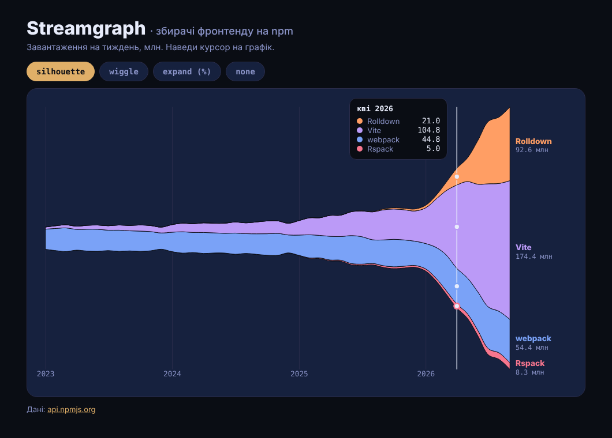

# Streamgraph

Streamgraph на D3: тижневі завантаження збирачів фронтенду з npm - **webpack**, **Vite**, **Rolldown** і **Rspack** - з січня 2023-го. Курсор показує значення за місяць, кнопки перемикають офсет стеку: `silhouette`, `wiggle`, `expand` (частки у %) і `none`.

> Пост [@nby.frontend](https://instagram.com/nby.frontend) #218 · ключ `Streamgraph`



## Запуск

```bash
npm i && npm run dev
```

Оновити дані до останнього повного місяця:

```bash
npm run data   # node scripts/fetch-npm.mjs > src/data.js
```

## Як це працює

1. **Стек** (`src/main.js`) - `d3.stack().keys(KEYS).offset(d3.stackOffsetSilhouette)` рахує для кожного місяця нижню й верхню межу потоку. Silhouette центрує потоки навколо нуля, wiggle ще й мінімізує їх «хитання», expand нормалізує до 100%.
2. **Шкала Y** - `d3.extent(series.flat(2))`: межі потоків бувають від'ємні, тому домен береться з самих даних, а не від нуля.
3. **Потоки** - `d3.area()` з `y0(d => y(d[0]))` і `y1(d => y(d[1]))`, крива `d3.curveCatmullRom` проходить через точки даних.
4. **Курсор** - `d3.bisector(d => d.date).center` + `x.invert()` знаходять найближчий місяць під мишею.
5. При зміні офсету потоки й підписи перетікають через `transition()`; `prefers-reduced-motion` вимикає анімацію.

## Дані

`scripts/fetch-npm.mjs` бере `api.npmjs.org/downloads/range/...` шматками по 18 місяців (більше API не віддає), сумує по місяцях і рахує середнє на тиждень: `сума / днів у місяці × 7`. Місяць, що більш ніж удвічі вищий за обидва сусідні, вважається аномалією й замінюється їх середнім (у даних так позначено `vite` за 2025-08).

Завантаження з npm - це не люди: туди входять CI-збірки, дзеркала й транзитивні залежності (Rolldown качають переважно разом із Vite 8). Порівнюй тренди, а не абсолютні числа.

## Файли

- `src/main.js` - стек, потоки, курсор, перемикач офсету
- `src/data.js` - згенеровані дані
- `scripts/fetch-npm.mjs` - збір даних з npm (Node 18+, без залежностей)
- `src/style.css` - Tokyo Night стилі

---

EN: D3 streamgraph of weekly npm downloads for webpack, Vite, Rolldown and Rspack since Jan 2023, with a hover cursor and switchable stack offsets (silhouette / wiggle / expand / none). `npm i && npm run dev`, refresh data with `npm run data`.
