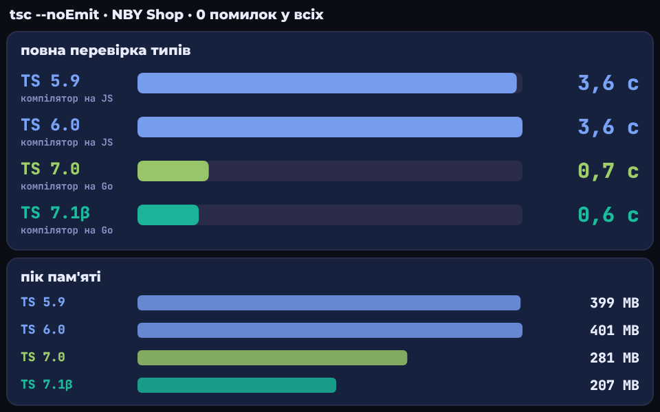

# TypecheckSpeed — tsc на TypeScript 5.9 / 6.0 проти нативного 7.0 / 7.1 beta

Пост #251 @nby.frontend. Замір 25.11.2026: NBY Shop (Next.js 16, 7 002 рядки власного TS, 760 файлів разом з типами залежностей), Node 22.23, Linux, 2 ядра, медіана з 5.



## Результат (`tsc -p tsconfig.json --noEmit`)

| | повна перевірка | повторно (.tsbuildinfo) | пік пам'яті | помилок |
|---|---|---|---|---|
| TypeScript 5.9.3 (JS) | 3 571 мс | 1 596 мс | 399 MB | 0 |
| TypeScript 6.0.3 (JS) | 3 625 мс | 1 540 мс | 401 MB | 0 |
| TypeScript 7.0.2 (Go) | **671 мс** | **343 мс** | 281 MB | 0 |
| TypeScript 7.1.0-beta (Go) | **577 мс** | **307 мс** | **207 MB** | 0 |

Додатково: крок «Running TypeScript» у `next build` (з кешем Next) — ~1,7 с на 5.9.3 проти ~0,4 с на 7.0.2 (по 2–3 прогони).

## Пастка: ESLint на TS 7.0

Якщо замінити `typescript` на 7.0 — `eslint .` падає:

```
typescript-eslint does not support TS 7.0.
```

TypeScript 7.0 не має API, на якому працюють typescript-eslint, Vue/Svelte/Angular-інструменти тощо (новий API — у 7.1). Рішення з [анонсу TypeScript 7.0](https://devblogs.microsoft.com/typescript/announcing-typescript-7-0/) — два пакети поруч:

```json
{
  "devDependencies": {
    "typescript": "npm:@typescript/typescript6@^6.0.2",
    "@typescript/native": "npm:typescript@^7.0.2"
  }
}
```

Перевірено на копії магазину: `npx tsc -v` → 7.0.2, `npx tsc6 -v` → 6.0.3, `npx eslint .` працює.

## Як повторити

```bash
mkdir ts && for v in 5.9.3 6.0.3 7.0.2 7.1.0-beta; do (mkdir -p ts/v$v && cd ts/v$v && npm init -y >/dev/null && npm i typescript@$v); done
node scripts/bench.mjs ../ShopProject ./ts 5    # → results.json
```

## Обмеження

Невеликий проєкт і 2 ядра: TypeScript 7 перевіряє паралельно, на машині з 8+ ядрами розрив, імовірно, буде більшим — але тут цього не міряли.
