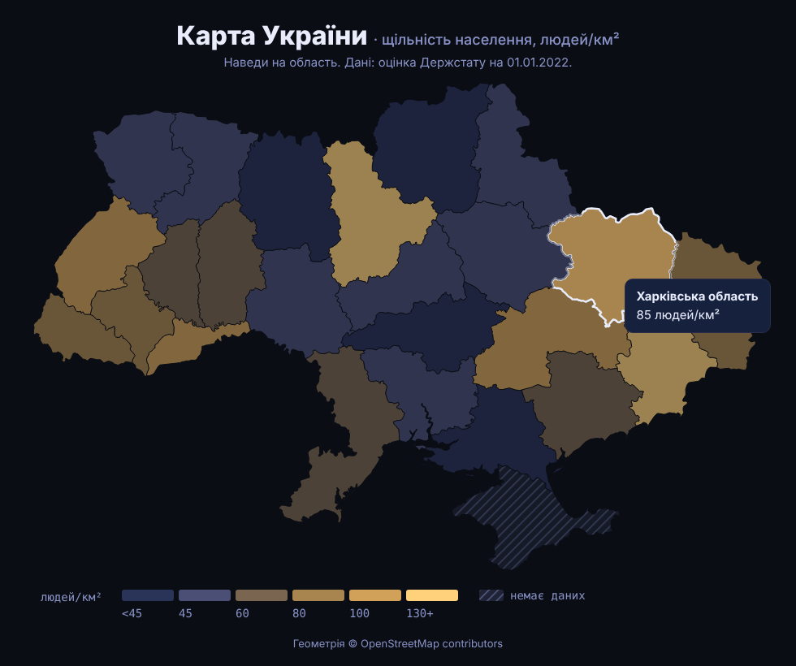

# UkraineMap

Choropleth-карта України на D3 з двома шарами: **щільність населення** (людей/км²) і **повітряні тривоги зараз** з відкритого API [NEPTUN](https://neptun.in.ua/) (без ключів і реєстрації).
Наведи на область — тултіп із назвою і значенням. Підміни `src/data.js` на свою метрику (продажі, користувачі…) — решта коду та сама.

> Пост [@nby.frontend](https://instagram.com/nby.frontend) #214 · ключ `UkraineMap`



## Запуск

```bash
npm i && npm run dev
```

## Як це працює

1. **Геометрія** — `public/ukraine-oblasts.geojson`: 24 області + АР Крим (спрощено до ~100 КБ). Ключ області — `properties.name_uk`.
2. **Проєкція** — `d3.geoMercator().fitSize([W, H], geo)` сама підбирає масштаб і центр під SVG.
3. **Контури** — `d3.geoPath(projection)` перетворює полігони на SVG `d`.
4. **Колір** — `d3.scaleThreshold().domain([45, 60, 80, 100, 130])`: 6 класів + легенда з межами.
5. **Немає даних** — штрихування через SVG `<pattern>`, область лишається на карті.
6. **Тривоги** (`src/alerts.js`) — `fetch("https://neptun.in.ua/api/v1/alerts")` → `{ oblasts, raions }`. `d3.rollup` рахує райони під тривогою в кожній області: усі райони або запис в `oblasts` → «уся область», частина → «частина районів». Оновлення раз на 30 с (NEPTUN просить не частіше ніж раз на 5 с).

## Дані

- Чисельність — оцінка Держстату на 01.01.2022 (до повномасштабного вторгнення), площі областей — за даними Вікіпедії ([Oblasts of Ukraine](https://en.wikipedia.org/wiki/Oblasts_of_Ukraine)); м. Київ — 2 952 301 ([citypopulation.de](https://citypopulation.de/en/ukraine/kievcity/)), 839 км².
- Київська область у цій геометрії включає м. Київ, тому значення рахується для них разом.
- АР Крим і Севастополь — частина карти України; актуальних даних немає, тому — штрихування.

## Тривоги — умови NEPTUN

- Видиме посилання на https://neptun.in.ua біля карти (є в підвалі сторінки).
- Опитування не частіше ніж раз на 5 с; для real-time у них є WebSocket.
- NEPTUN — інформаційний агрегатор, **не офіційна система оповіщення**: дані можуть бути неточними чи із затримкою. Для безпеки — лише офіційні сигнали.

## Ліцензії

Геометрія: © [OpenStreetMap contributors](https://www.openstreetmap.org/copyright) (ODbL), через [EugeneBorshch/ukraine_geojson](https://github.com/EugeneBorshch/ukraine_geojson), спрощено.

---

EN: D3 choropleth map of Ukraine — population density per oblast (2022 estimate), threshold color scale, hover tooltip, hatched "no data". `npm i && npm run dev`.
