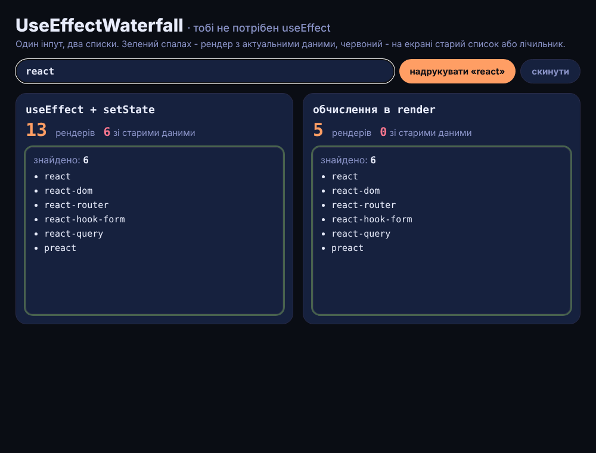

# UseEffectWaterfall

Один і той самий пошук по 72 frontend-пакетах, зроблений двічі: похідні дані (відфільтрований список і лічильник) у **state + useEffect** і ті самі дані, **обчислені прямо в render**. Рамка результату спалахує зеленим, коли на екрані актуальні дані, і червоним, коли React закомітив кадр зі старим списком або лічильником.

> Пост [@nby.frontend](https://instagram.com/nby.frontend) #221 · папка `UseEffectWaterfall`



## Запуск

```bash
npm i && npm run build && npm run preview
```

Міряй у production-збірці: `StrictMode` вимкнено навмисно, бо він рендерить двічі.

## Результат (25.10.2026)

React 19.3.1, Chromium, «react» набрано по літері:

| Літера | useEffect + setState | обчислення в render |
|---|---|---|
| r, e, a | 3 рендери, 2 зі старими даними | 1 |
| c, t | 2 рендери (список не змінився, але `setList` з новим масивом — ще рендер) | 1 |
| **разом** | **13, з них 6 зі старими даними** | **5, 0** |

У консолі браузера `__stats()` покаже ці числа.

## Чому так

`src/SearchEffect.jsx`: зміна `query` → рендер зі старим `filtered` → ефект `setFiltered` → рендер зі старим `count` → ефект `setCount` → третій рендер. Ефекти виконуються після того, як кадр уже показано, тож проміжні стани потрапляють на екран.

`src/SearchRender.jsx`: `const filtered = PACKAGES.filter(...)` прямо в тілі компонента — список і лічильник завжди з одного `query`, один рендер на літеру.

Правило з документації React («You Might Not Need an Effect»): якщо значення можна порахувати з props або state, рахуй під час рендеру. `useMemo` — лише для справді важких обчислень. `useEffect` — для синхронізації із зовнішнім світом.

## Як рахуються рендери

`src/tracker.js`: `useLayoutEffect` без залежностей спрацьовує раз на кожен закомічений рендер, записує його й перевіряє, чи список і лічильник на екрані відповідають поточному запиту (`isConsistent` у `src/matches.js`). Лічильники — окремий компонент, тож їх оновлення не перемальовує панелі пошуку.

## Файли

- `src/SearchEffect.jsx` — варіант з useEffect
- `src/SearchRender.jsx` — варіант з обчисленням у render
- `src/tracker.js`, `src/matches.js` — підрахунок рендерів і перевірка узгодженості
- `src/App.jsx` — інпут, кнопка «надрукувати react», дві панелі

---

EN: The same search built twice — derived state synced with useEffect vs computed during render. Typing "react": 13 renders (6 showing stale data) vs 5 (React 19.3, production build). `npm i && npm run build && npm run preview`.
