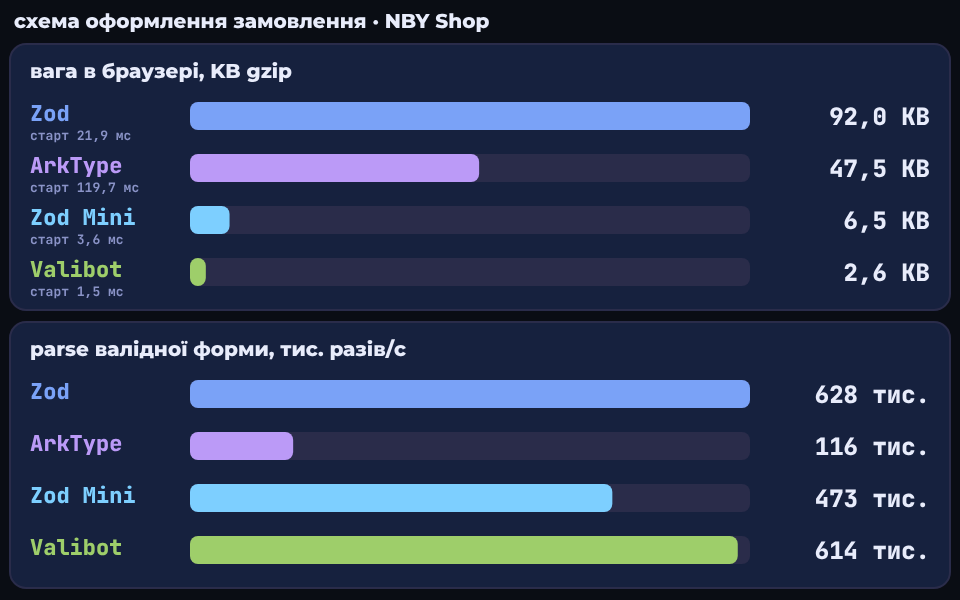

# ValidatorRace — Zod, Zod Mini, Valibot, ArkType на справжній схемі

Пост #250 @nby.frontend. Замір 24.11.2026: zod 4.6.7, valibot 1.5.0, arktype 2.2.10, esbuild 0.28.2, Node 22.23, Linux, 2 ядра.



## Схема

`checkoutSchema` з NBY Shop (`lib/checkout-schema.ts`): 11 полів, `trim`, email, телефон `+380XXXXXXXXX`, два enum, необов'язкові поля картки й перевірка картки (Luhn, термін, CVC), якщо оплата карткою. Переписана 1:1 у `schemas/` — `zod.ts`, `zod-mini.ts`, `valibot.ts`, `arktype.ts`; спільні `card.ts` і `inputs.ts` (валідна форма і форма з 5 помилками).

## Результат (медіана з 5, кожен валідатор — окремий процес)

| | gzip у браузері | min | parse, валідна, разів/с | parse, 5 помилок, разів/с | холодний старт |
|---|---|---|---|---|---|
| Zod (`zod`) | 92,0 KB | 445,5 KB | **627 670** | 232 653 | 21,9 мс |
| Zod Mini (`zod/mini`) | 6,5 KB | 18,6 KB | 473 376 | 199 015 | 3,6 мс |
| Valibot | **2,6 KB** | 7,0 KB | 613 961 | **402 339** | **1,5 мс** |
| ArkType | 47,5 KB | 154,8 KB | 115 628 | 66 737 | 119,7 мс |

- **Вага** — esbuild-бандл точки входу `export { validate } from "./schemas/<lib>"` (browser, esm, minify) → gzip.
- **Швидкість** — tinybench (1,5 с на задачу після прогріву).
- **Холодний старт** — від `import()` модуля до кінця першого `validate()`: створення схеми + перший parse.

## Відмінності поводження

Zod, Zod Mini і Valibot на невалідній формі повертають усі 5 помилок одразу. В ArkType `narrow()` (перевірка картки) запускається лише коли решта полів валідні — тож спершу 3 помилки, а помилки картки — наступним кроком.

## Запуск

```bash
npm i
npm run bench     # → results.json, build/
```
