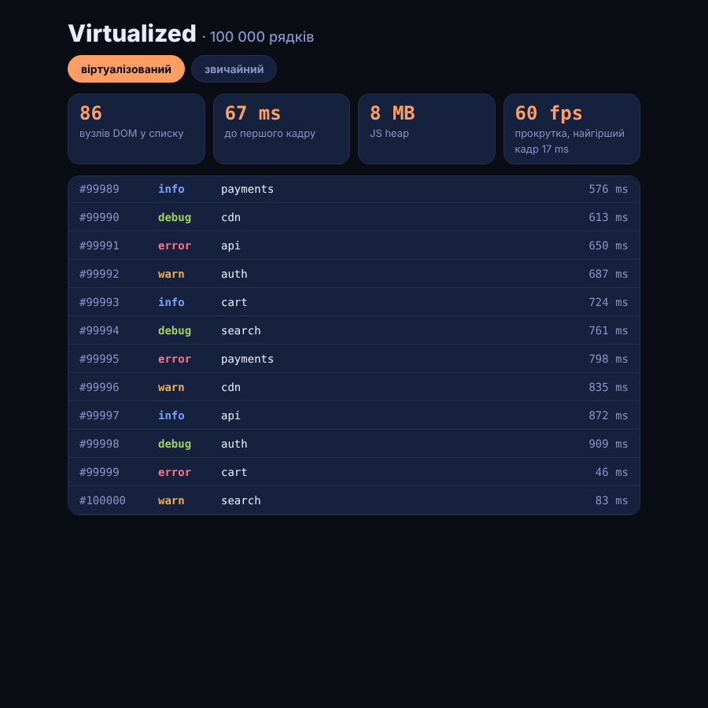

# Virtualized

Список із 100 000 рядків логів, відрендерений двічі: звичайним `map()` і з віртуалізацією через **TanStack Virtual**. Над списком — живі заміри: скільки вузлів DOM, скільки часу до першого кадру, скільки пам'яті JS, і кнопка тесту прокрутки.

> Пост [@nby.frontend](https://instagram.com/nby.frontend) #224 · папка `Virtualized`



## Запуск

```bash
npm i && npm run build && npm run preview
```

Відкрий `?mode=virtual` або `?mode=plain` — кожен режим вантажиться у свіжій сторінці, щоб заміри не заважали один одному. JS heap показує лише Chromium (`performance.memory`).

## Результат (27.10.2026)

React 19.3.1, @tanstack/react-virtual 3.14.23, production-збірка, headless Chromium, медіана з 3 запусків:

| | звичайний | віртуалізований |
|---|---|---|
| вузлів DOM у списку | 500 000 | 86 |
| до першого кадру | 5 548 ms | 67 ms |
| JS heap | 181 MB | 8 MB |
| прокрутка за 3 с | 43–60 fps, найгірший кадр 33 ms | 60 fps, найгірший кадр 17 ms |

Висновок: коли список уже намальовано, браузер прокручує його нормально — біль у старті й пам'яті.

## Як це працює

- `src/PlainList.jsx` — `rows.map(...)`: 100 000 рядків × 5 вузлів одразу в DOM.
- `src/VirtualList.jsx` — `useVirtualizer({ count, getScrollElement, estimateSize, overscan: 5 })`. Внутрішній div має повну висоту (`getTotalSize()`), щоб скролбар був «на 100 000», а рендеряться лише `getVirtualItems()` — видимі рядки плюс 5 запасу, зсунуті через `translateY`.
- `src/measure.js` — час від старту модуля до кадру після першого коміту, підрахунок вузлів і програмна прокрутка через `requestAnimationFrame` з тривалістю кожного кадру.

## Ціна віртуалізації

- Ctrl+F браузера не знайде рядки поза екраном.
- Для рядків різної висоти потрібен `measureElement`.
- Скрінрідерам і SEO недоступне те, чого немає в DOM.
- До ~500 простих рядків зазвичай не потрібна.

## Файли

- `src/PlainList.jsx`, `src/VirtualList.jsx`, `src/Row.jsx` — два списки й рядок
- `src/rows.js` — 100 000 детермінованих рядків
- `src/measure.js` — заміри
- `src/App.jsx` — перемикач режимів і панель метрик

---

EN: The same 100,000-row list rendered plainly and with TanStack Virtual. Plain: 500k DOM nodes, 5.5 s to first frame, 181 MB heap; virtualized: 86 nodes, 67 ms, 8 MB (React 19.3, headless Chromium). `npm i && npm run build && npm run preview`, then `?mode=plain` / `?mode=virtual`.
